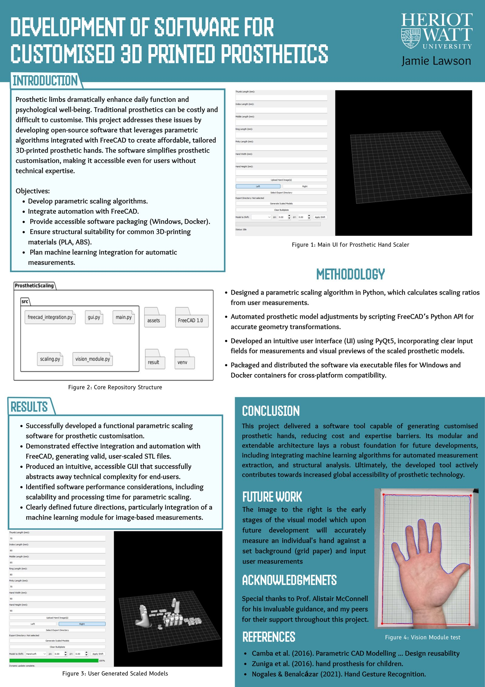

3D-printed prosthetic hands are cheap, but fitting one to a person still needs someone who
knows CAD. For my undergraduate dissertation I built a desktop app that does the resizing:
you put in hand measurements, it reshapes the model in FreeCAD, and you get files ready to print.

## What I built

- A scaling algorithm in Python that works out ratios from the measurements
- Scripts that drive FreeCAD's Python API to reshape the model
- A PyQt5 interface with a live 3D preview (VTK)
- Packaged as a Windows app and as a Docker container

*Supervised by Prof. Alistair McConnell.*

## Measuring a hand from a photo

The part I enjoyed most was trying to measure a hand from a photo taken on grid paper, so
nobody would need a tape measure. It was still early when the project ended. These are the
versions in order, from wrong to less wrong:

