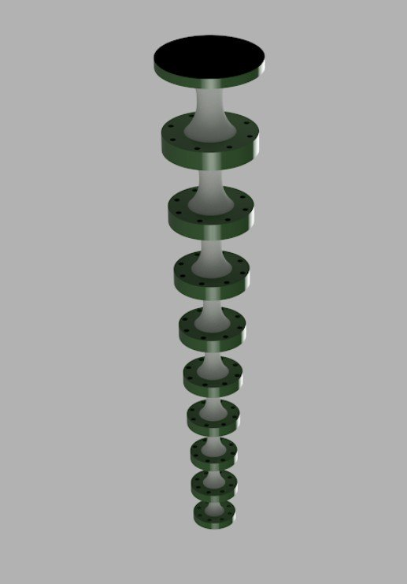

<!-- Draft: add what the tentacle does, how it's driven, and what your part was. -->

A Bristol group project on a segmented robot tentacle, pitched as a way to grab debris in orbit.
Here's the video we made:

<iframe src="https://www.youtube-nocookie.com/embed/NdVbOA9UTBA" title="Group project video" loading="lazy" allow="accelerometer; encrypted-media; gyroscope; picture-in-picture" allowfullscreen></iframe>

{: .narrow}
