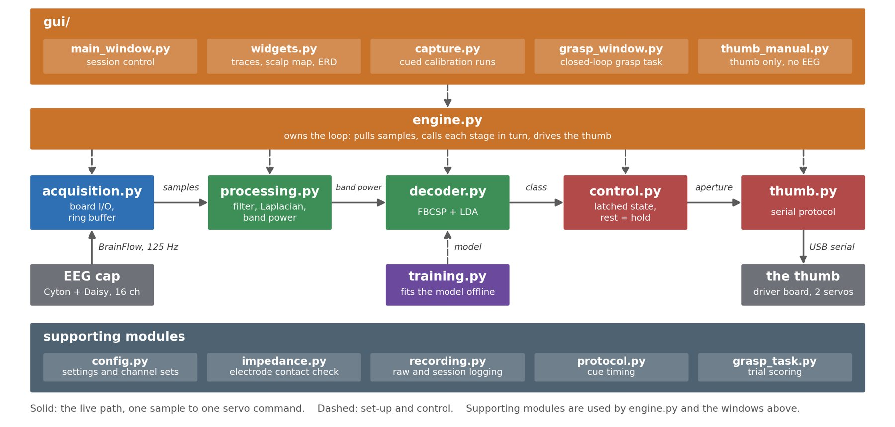

An extra robotic thumb doesn't replace anything. It adds a digit you never had, which makes
controlling it awkward: most controllers borrow a body part you're already using. For my MSc
dissertation I tried driving one from imagined movement instead, read through an EEG cap on
consumer OpenBCI hardware.

## How it works

The cap streams brain signals into a Python pipeline. It filters them, measures the power in
the frequency bands linked to movement, and hands that to a decoder (filter-bank CSP with
linear discriminant analysis). The decoder picks one of three commands, and a small control
layer turns that into a position for the thumb's servos.

## What I found

- The three-command decoder got about **80% accuracy on eight electrodes**, and held up when
  whole recording sessions were left out of training
- Halving the number of electrodes didn't reliably make it worse. Going down to three did
- Over **60 closed-loop trials** the thumb did its job **80% of the time**. When it failed, it was
  mostly while holding a grip, not starting one
- The decoder sometimes fired when people gripped with their real hand. That could be a real
  interference problem, but I didn't have enough evidence to call it one

## What I'd do next

Work on holding a command steady, since that's where it broke down, and test with more people.

*The participants' recordings stay private, as they're brain data.*
